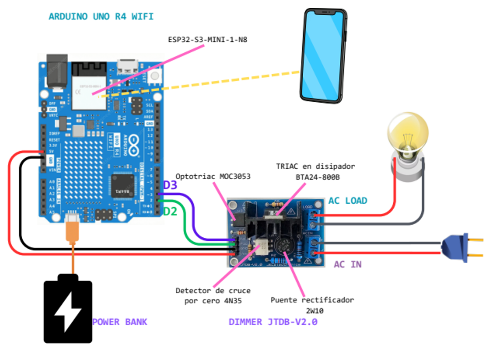

# Control inalámbrico de potencia de una lámpara incandescente (Arduino UNO R4 WiFi + Android)

Proyecto individual del Extraordinario de Fundamentos de Sistemas Embebidos perteneciente al segundo período del semestre 2027-1 (Facultad de Ingeniería, UNAM).
Autor: Jiménez Chávez Daniel Orlando.

El sistema regula de 0 a 100 % la potencia de una lámpara incandescente de 100 W (110–130 V) desde una app Android nativa (Kotlin). El Arduino UNO R4 WiFi opera como punto de acceso (AP) y servidor HTTP, y dispara un TRIAC mediante un módulo dimmer comercial con detección de cruce por cero.

> **Advertencia de seguridad:** el módulo y la lámpara trabajan con 127 V de corriente alterna. Desconecte la clavija antes de tocar el cableado y no manipule el módulo energizado.

## Requerimientos

### Hardware
- Arduino UNO R4 WiFi.
- Módulo dimmer de luz AC de 1 canal JTDB-V2.0 (2W10 + 4N35 para el cruce por cero; MOC3053 + TRIAC BTA24-800B para el disparo): [enlace de compra](https://www.mercadolibre.com.mx/modulo-dimmer-de-luz-ac-control-potencia-1-canal/up/MLMU721185363)
- Lámpara incandescente de 100 W (110–130 V), con socket y clavija.
- Powerbank o cargador USB-C de 5 V para operación autónoma (o cable USB-C a la computadora).
- Dispositivo Android 8.0+ con WiFi.

### Diagrama de conexiones



| Módulo dimmer | Arduino | Función |
|---|---|---|
| VCC | 5V | Alimentación del dimmer |
| GND | GND | Tierra |
| PZC | D2 | Cruce por cero (interrupción por flanco de subida) |
| PD | D3 | Disparo del TRIAC (nivel alto) |

La línea de CA entra por `AC IN` del módulo y la lámpara se conecta a `LOAD`.

### Software
- Arduino IDE con el paquete de placas **Arduino UNO R4 Boards** instalado (incluye la librería `WiFiS3`). [Descarga](https://www.arduino.cc/en/software/](https://www.arduino.cc/en/software/))
- Android Studio, con un teléfono físico (depuración USB) para compilar e instalar la app. [Descarga](https://developer.android.com/studio/install?hl=es-419)

## Estructura del repositorio

```
firmware/      dimmer_wifi.ino, config.h, dimmer.h/.cpp, wifi_ap.h/.cpp, http_api.h/.cpp
app-android/   Proyecto de Android Studio (Kotlin)
docs/          Reporte en PDF y figuras
```

## Compilar y cargar el firmware
1. Abra `firmware/dimmer_wifi.ino` en el Arduino IDE (los demás archivos deben estar en la misma carpeta).
2. Selecciona la placa **Arduino UNO R4 WiFi** y el puerto.
3. Pulse **Verificar** y después **Subir**. La consola muestra el uso de memoria (≈ 24 % de flash y 23 % de SRAM).
4. Alimente la placa. Al arrancar crea la red WiFi del Arduino. El SSID y contraseña están definidos n `config.h` como `AP_SSID = "DimmerEXTRA"` y `AP_PASS = "dimmerEXTRA"`.
   

Si falla una inicialización, la carga se apaga y el LED integrado parpadea: 1 vez (temporizador), 2 veces (módulo WiFi) o 3 veces (punto de acceso).

## Instalar y usar la app Android

Requiere Android 8.0 (API 26) o superior. Hay dos formas de obtener la app.

### Opción A: instalar el APK ya compilado

1. Descargue el APK desde el repositorio: `apk/app-debug.apk`
   (abra el archivo en GitHub y pulsa **Download raw file**), o desde la sección **Releases** del repositorio.
2. Páselo al teléfono (descarga directa desde el navegador del teléfono, o por cable USB).
3. Ábralo en el teléfono. Si Android lo pide, permita **instalar apps de orígenes desconocidos** para el navegador o el administrador de archivos que use.
4. Instala la app y ábrela.

### Opción B: compilar desde el código fuente

1. Descomprima y abra `app-android/` en Android Studio.
2. Conecta el teléfono por USB con la depuración USB activada y pulsa **Run**.

### Uso (ambas opciones)

1. Alimenta el Arduino y espera a que cree su red WiFi.
2. En el teléfono, conéctate a la red WiFi del Arduino.
3. Abre la app y mueve el slider; el valor se envía al soltarlo.

## API HTTP (servidor en 192.168.4.1)

| Petición | Respuesta |
|---|---|
| `GET /set?power=N` (N de 0 a 100) | Fija la potencia |
| `GET /status` | Devuelve el estado actual |
| `power` fuera de rango o no numérico | HTTP 400 |
| Ruta inexistente | HTTP 404 |

Prueba sin la app, desde un navegador conectado a la red del Arduino: `http://192.168.4.1/set?power=50`.

## Reproducir las pruebas
- **Cruce por cero:** se verificaron 120 pulsos por segundo en D2 con un sketch de diagnóstico.
- **Rango útil:** se barrió el slider y se observó el filamento; el brillo es apreciable entre 11 % y 90 %. Los límites se ajustan con `MIN_UTIL` y `MAX_UTIL` en `config.h`.
- **Latencia:** el cronómetro de la app midió 150.4 ms de promedio (n = 11, mín. 129 ms, máx. 178 ms).
- **Autonomía:** el sistema funcionó con powerbank, sin computadora, más de 10 minutos sin reiniciar.

## Limitaciones conocidas
- No se midió el tiempo de ejecución de las ISR ni se verificó con osciloscopio la causa física del ajuste `MARGEN`.
- `contador` se modifica en ambas ISR; la mejora propuesta es que solo `onTick` lo escriba.
- El servidor atiende un cliente a la vez.

## Declaración de uso de IA
Se usó Claude Sonnet 5.5 como apoyo en el código, el reporte y las figuras. El detalle está en la sección final del reporte (`docs/`).
